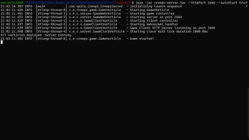
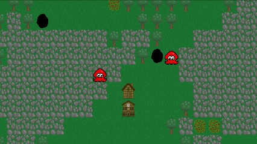

# Creeps - Asynchronous AI Bot

> **Showcase Repository:** This repository serves as an architectural showcase. To comply with EPITA's anti-plagiarism rules, the full raw source code is kept private, but core architectural concepts, engine design, and concurrent patterns are documented below.

## 📖 Project Context

**Creeps** is an EPITA development project focusing on interacting with a real-time strategy game server via a REST API. The challenge lies in managing thousands of units (citizens, turrets, bomber bots) simultaneously, parsing massive JSON payloads, and executing commands (move, gather, build) under strict time delays, all while surviving aggressive server garbage collection.

## 🏗️ Architectural Overview

The application is built around a non-blocking, highly concurrent engine designed to handle network latency and swarm management seamlessly.

### 1. Goal-Oriented AI Design
Instead of a monolithic state machine, the bot uses a **Goal-Oriented Modular approach**. The codebase is designed to be injected with specific strategies per run (e.g., "Resource Gathering Mode", "Expansion Mode", "Combat Mode"). This allowed for aggressive and focused achievement hunting across different server instances without bloating the core decision-making loop.

### 2. Independent Asynchronous Agents (Actor-like Model)
Instead of a centralized, blocking controller bottleneck, the bot treats each spawned unit as an independent asynchronous agent. Each unit receives its own non-blocking execution loop via `CompletableFuture`, allowing thousands of citizens to evaluate their surroundings and execute commands in parallel.

## 🚀 Technical Highlights & Snippets

### Non-blocking Execution & Rate Limiting
To survive the server constraints, the core network wrapper handles HTTP requests and mandatory cooldowns asynchronously using Java's `delayedExecutor`, freeing the main thread pool:

```java
// Delayed execution to respect strict game constraints without thread blocking
public CompletableFuture<Void> waitAsync(long duration, TimeUnit unit) {
    return CompletableFuture.runAsync(() -> {},
            CompletableFuture.delayedExecutor(duration, unit));
}

// Wrapping HTTP calls into managed tasks
public JSONObject executeAndWait(String unitId, String opcode, String bodyContent) {
    try {
        var response = Unirest.post(url + "/command/" + login + "/" + unitId + "/" + opcode)
                .body(bodyContent).asJson();
        JSONObject body = response.getBody().getObject();
        
        // Handle server cooldowns seamlessly
        if (body.has("errorCode")) {
            waitAsync(200, TimeUnit.MILLISECONDS).join();
            return null;
        }
        
        if (!body.has("reportId")) return null;
        String reportId = body.getString("reportId");

        while (true) {
            var reportResp = Unirest.get(url + "/report/" + reportId).asJson();
            JSONObject report = reportResp.getBody().getObject();

            if (!"noreport".equals(report.getString("opcode"))) {
                return report;
            }
            waitAsync(50, TimeUnit.MILLISECONDS).join();
        }
    } catch (Exception e) {
        return null;
    }
}
```

### Autonomous Agent Lifecycle
Here is an example of how specific behaviors (like exploring or spamming) are injected into a unit's lifecycle. The main thread simply spawns these futures and groups them together:

```java
public static CompletableFuture<Void> runExplorer(Server server, String unitId, String mainDirection) {
    return CompletableFuture.runAsync(() -> {
        while (true) {
            // Independent decision loop
            server.executeAndWait(unitId, "gather", "{}");
            server.executeAndWait(unitId, "build:road", "{}");
            server.executeAndWait(unitId, mainDirection, "{}");

            // Random variation to avoid deterministic loops
            if (Math.random() < 0.1) {
                server.executeAndWait(unitId, "move:up", "{}");
            }
        }
    });
}

// In the main thread:
// CompletableFuture.allOf(explorer1, explorer2, spammer1).join();
```

## 🎯 Demonstration

Visual proof of the bot running asynchronously on the local testing server.

* **Server Activity (Terminal Logs):** Demonstrates real-time, parallel processing of independent unit agents.


* **Game Map Execution (Web Viewer):** Shows the citizen swarms gathering resources and building roads autonomously.

